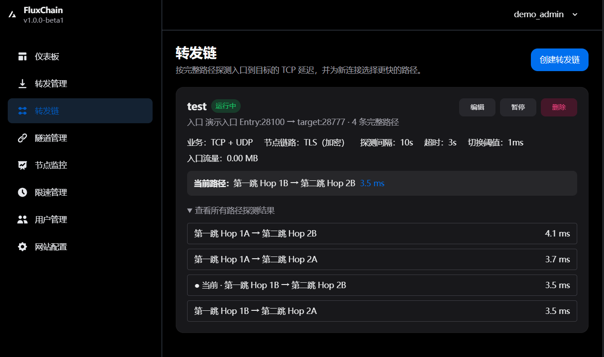
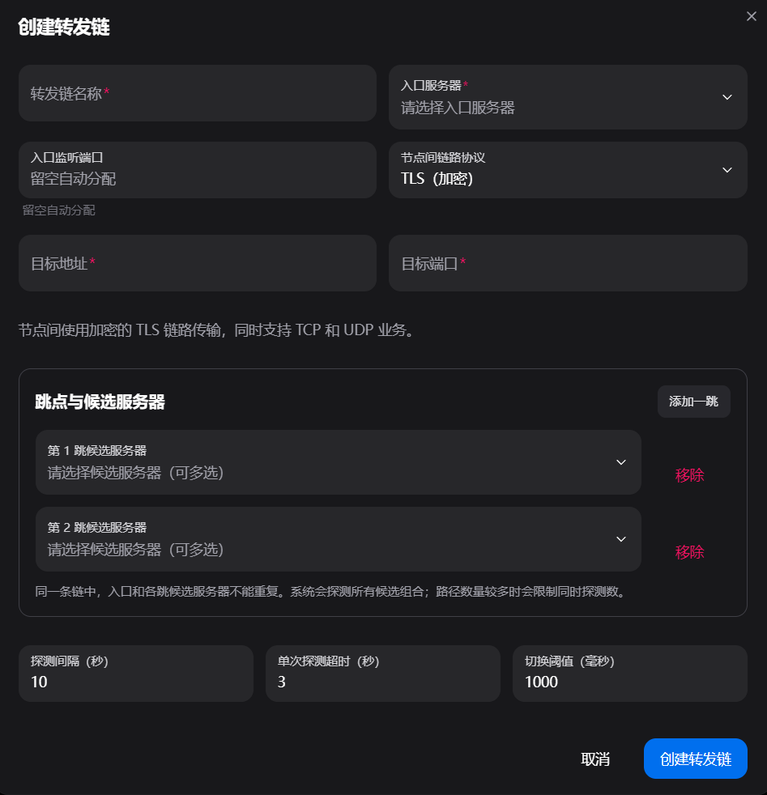

# FluxChain

**v1.0.1** · 基于 GOST 的转发管理面板，支持多跳转发链、完整路径探测和自动选路。

基于 [Flux Panel v1.4.3](https://github.com/bqlpfy/flux-panel) 二次开发，保留上游署名和许可证。项目地址：[Toto0912/flux-chain](https://github.com/Toto0912/flux-chain)。

## 界面演示

转发链列表：查看当前路径及所有完整路径的探测结果。



创建转发链：选择入口与各跳候选服务器，设置节点间传输方式和探测参数；入口端口支持留空自动分配。



## 功能与使用提醒

- 保留端口转发、隧道转发、用户配额、流量统计、倍率及限速管理；转发链暂仅管理员可用。
- 每跳可配置多个候选节点，枚举完整路径，按入口经过整条链到目标的单次 TCP 建连延迟选路；仅影响新连接，已有连接不迁移。
- 路径切换需比当前路径快出设定阈值。全部探测失败时保留上次路径，首次创建使用第一条路径。
- 转发链仅统计入口流量，沿用现有配额和计费规则，中间节点不重复计费。
- 入口监听端口可留空，自动分配节点范围内的空闲端口；普通转发、转发链及保留端点统一避让，暂停后仍保留端口。编辑同一入口时留空会保留原端口。
- 同一链内入口和各跳节点不能重复；被转发链使用的节点不能删除。下发失败会清理或尝试回滚，暂停状态显示红色标记。

| 探测设置 | 默认值 | 可选范围 |
| --- | --- | --- |
| 探测间隔 | 5 分钟 | 10 秒～60 分钟 |
| 单次超时 | 3 秒 | 1～5 秒 |
| 切换阈值 | 1000ms | 1ms～单次超时时间 |

不限制完整路径数量，同时最多执行 16 个探测。同一条链上一轮探测未完成时，不重复排队；等待中的任务也受并发队列限制，空闲后自动重试。路径数为各跳候选数量的乘积，候选过多时一轮探测会变长。

### 节点间传输方式

入口始终同时转发 TCP 和 UDP，下面的选项决定节点之间如何承载数据：

| 方式 | TCP 业务 | UDP 业务 |
| --- | --- | --- |
| TLS | TLS 加密中继 | 封装在 TLS 中继中 |
| QUIC | QUIC 加密可靠流 | 封装在 QUIC 可靠流中 |
| TCP | 明文 TCP 中继 | 封装在明文 TCP 中继中 |
| UDP | 配套明文 TCP 中继 | 逐跳原生 UDP，无额外可靠重传层 |

业务自身的加密保持原样。明文模式不额外保护链路，TCP 中继握手认证信息也不受 TLS 保护。UDP 模式的两种业务同步选路，节点防火墙需同时放行实际使用端口的 TCP 和 UDP。

普通转发、隧道转发及转发链的 UDP 入口均配置完整报文缓冲区，避免默认 8KB 缓冲区截断大报文。已有普通转发升级后需编辑保存一次，重新下发监听配置。

**选路探测的是 TCP 参考延迟，不是真实 UDP 延迟，也不能证明 UDP 可达。** 目标只监听 UDP 时，TCP 诊断和路径探测可能失败，但 UDP 业务仍可转发，按上述失败回退规则运行。同机容器验证不能代表公网游戏的延迟、抖动和丢包表现。

## 安装面板

面板支持 **x86_64 Linux**，使用 MySQL 5.7；节点支持 amd64 和 arm64。预先安装 Docker Engine、Docker Compose v2、curl（或 wget）、tar、sha256sum。低内存 VPS 应先准备足够的交换空间，避免安装时内存耗尽。

直接在当前目录中运行：

```bash
curl -fL --retry 2 https://raw.githubusercontent.com/Toto0912/flux-chain/main/panel_install.sh -o panel_install.sh
sudo bash panel_install.sh install
```

默认下载并校验对应 Release 的部署资源及镜像，无需在 VPS 编译。镜像仓库不可用时尝试同版本 Release 镜像包。默认前端端口 `6366`、后端端口 `6365`，安装时可修改。

**v1.0.1 起默认仅使用 IPv4 容器内网**；不再根据宿主机 IPv6 地址自动创建 IPv6 桥接网络。`PANEL_IPV6=0` 与旧值 `auto` 均选择 IPv4 内网。宿主机 IPv6 访问可由 Docker 默认开启的 `userland-proxy` 转至 IPv4 容器，因此节点仍可通过 IPv6 连接面板，节点上的 IPv6 转发不受影响；面板容器自身没有原生 IPv6 出站能力。若服务器关闭了该代理，脚本不会擅自更改 Docker 配置，应由管理员另行安排 IPv6 入口代理。

只有明确需要容器原生 IPv6 时才使用 `sudo env PANEL_IPV6=1 bash panel_install.sh install`。脚本会只读检查依赖 RA 的网卡；当 `accept_ra` 不为 `2` 或无法完成检查时停止，防止 Docker 开启 IPv6 转发后默认路由过期。脚本不修改宿主机 sysctl、路由、网卡配置或 Docker daemon 配置；Docker 正常创建桥接、端口映射及防火墙规则的行为仍然存在。

默认管理员：`admin_user / admin_user`，首次登录后修改密码。在网站配置中填写节点可访问的**后端地址和端口**，然后添加节点。当前沿用原项目容器名和全局数据卷名，同一 Docker 主机只部署一套，避免与其他 Flux 面板冲突。

### 使用原项目数据库备份

全新安装时，将备份副本命名为 `gost.sql`，放到 `panel_install.sh` 同目录，再执行安装。脚本优先使用已有 SQL，仅在不存在时下载默认初始化文件；空文件、不可读文件或目录会报错停止。数据库初始化完成并成功迁移后才启动面板；恢复后使用原账号密码。

**SQL 仅在全新的 MySQL 数据卷初始化时导入。** 已有数据库卷不会因为替换 `gost.sql` 重新导入；已有部署应使用更新或单独规划恢复。保留原始备份、安装生成的 `.env` 和数据库卷，不要重新生成原数据库密码。

## 安装与更新节点

在“节点监控”添加服务器，点击“安装”，复制在线或离线命令，在节点以 root 执行。节点需使用 systemd；安装目录 `/etc/gost`，服务名 `gost.service`。必须使用本项目定制节点，不能直接替换为原版 GOST。

在线安装：

```bash
curl -fL --retry 2 https://github.com/Toto0912/flux-chain/releases/download/v1.0.1/install.sh -o install.sh
sudo bash ./install.sh -a '面板地址:6365' -s '节点密钥'
```

中国大陆服务器下载较慢时，先下载同版本 `install.sh` 和 `gost-linux-amd64`，上传到节点同一目录，进入该目录执行：

```bash
# 离线安装；ARM64 节点将文件名替换为 gost-linux-arm64
sudo bash ./install.sh -b ./gost-linux-amd64 -a '面板地址:6365' -s '节点密钥'
# 使用本地新程序更新已有节点
sudo bash ./install.sh -u -b ./gost-linux-amd64
```

在线更新先下载目标版本脚本，再执行 `sudo bash ./install.sh -u`。脚本同目录若留有旧二进制，应移开或用 `-b` 明确指定新程序。更新保留 `config.json` 与 `gost.json`，新程序校验失败不会停止旧服务。

新版脚本显示下载进度并设置超时及有限重试，可用 `NODE_DOWNLOAD_TIMEOUT=600` 延长节点文件单次下载时限。服务日志用 `journalctl -u gost -n 100 --no-pager` 查看。

## 更新、源码构建与离线部署

### 更新已有面板

在原部署目录操作：

```bash
sudo bash panel_install.sh backup
curl -fL --retry 2 https://raw.githubusercontent.com/Toto0912/flux-chain/main/panel_install.sh -o panel_install.sh
sudo bash panel_install.sh update
```

已有 `gost-network` 的网络模式与本次选择不一致时，安装或更新会提前停止，不会自动删除网络或改变数据卷。旧版 IPv6 部署若保留原模式，使用 `sudo env PANEL_IPV6=1 bash panel_install.sh update`，仍须通过上述 RA 安全检查。改用 IPv4 内网应先备份，并在维护窗口停止此面板的容器、移除仅属于该面板的旧网络，再以 IPv4 配置重建；保留 `.env` 和全部数据卷，不使用 `--volumes`。删除 IPv6 网络不会自动撤销 Docker 已改变的宿主机转发参数，不能直接删除先前的 RA 修复；还原原网络参数需要管理员单独确认。

更新保留 `.env`、数据库和日志卷，容器重建及迁移期间面板会短暂中断。不要用重新安装替代更新，也不要删除 `mysql_data`；移动目录应保留原 Compose 项目名。卸载会删除数据，先另行保存备份。

当前单后端部署中，普通转发与转发链共享端口配置锁，覆盖端口分配、下发及数据库提交，防止同时创建或修改时争用端口；不影响正常转发流量。

升级节点与面板后，已有转发链需编辑并保存一次，重新下发探测握手和服务配置；保存可能中断业务，请选择合适时间。探测并发隔离及 QUIC 端口释放修复需要使用更新后的节点程序，建议入口和各跳节点同步更新；慢探测不会再串行阻塞管理命令，QUIC 服务删除后会释放底层 UDP 端口。

**v1.0.0 为首个正式版本。** 测试版部署可按上述步骤更新至正式版；节点需使用同一正式版本。离线部署请下载当前版本离线包与校验清单，不再使用测试版资源。

### 从当前源码构建

下载完整仓库，在根目录运行（已有部署改用 `update`）：

```bash
sudo env PANEL_IMAGE_MODE=build bash panel_install.sh install
# 编译节点，需要 Go 1.23.4+ 或 Docker，输出至 artifacts/
bash build_node.sh amd64
bash build_node.sh arm64
```

源码构建仍需联网获取基础镜像和编译依赖。仓库不包含依赖缓存、已编译程序、离线镜像、测试数据库或运行密钥。

### 离线安装面板

在联网机器下载同一 Release 的 `fluxchain-offline-amd64-v1.0.1.tar.gz` 与 `SHA256SUMS`，按清单核对该文件的 SHA-256 后上传。目标机器需预先安装 Docker 和 Compose：

```bash
mkdir fluxchain
cd fluxchain
tar -xzf ../fluxchain-offline-amd64-v1.0.1.tar.gz
sudo env PANEL_IMAGE_MODE=load bash panel_install.sh install
```

离线包包含面板、MySQL 镜像及部署资源，`load` 模式不在线拉取镜像；不包含 Docker/Compose 安装程序。已有部署在原目录执行 `update`，保留 `.env`。使用旧版离线包恢复备份前，应将其中的安装脚本替换为包含 SQL 保留与迁移修复的新版脚本。

## 流量统计与日志

流量由节点实时上报并入库，**不依赖运行日志，日志轮转不会清除流量统计。**

- Docker 日志：每份 50MB，最多保留 7 份；重建对应容器后应用。
- 后端文件日志：约 100MB 或跨天轮转，历史归档压缩后总量上限 1GB、最长 30 天，先达到的条件先清理；当前写入文件不计入历史上限，异步清理可能短暂超出。
- 旧版其他命名的日志需备份后单独清理；节点 journald 日志由宿主机管理。

可用 `docker inspect -f '{{json .HostConfig.LogConfig}}' springboot-backend` 查看容器日志限制。

## 开发与发布

版本以根目录 `VERSION` 为准，前后端、节点、脚本和 Compose 保持一致。提交源码前运行 `python3 scripts/check_release.py`；不要提交 `.env`、数据库备份、节点密钥、`node_modules`、`target`、`dist` 或本机工具链。

GitHub Actions 会执行后端测试、前端构建、节点探测测试和安装脚本检查。发布时先确认验证通过，再推送与 `VERSION` 一致的 `v版本号` 标签。后续发布使用新版本号并更新本文下载地址，确保标签、镜像、附件及 `SHA256SUMS` 对应同一份源码。工作流使用 `GITHUB_TOKEN` 构建并发布镜像、两种架构节点、部署包、离线包及校验清单。GHCR 镜像需设为 Public 供匿名拉取。

发布后仍需在全新目录验证实际下载、安装、登录、添加节点及 TCP/UDP 转发；源码构建通过不等于发布下载链路验证通过。自动测试和同机容器结果仅代表对应测试范围。

## 来源与许可证

- 基于 [bqlpfy/flux-panel](https://github.com/bqlpfy/flux-panel) v1.4.3，保留根目录 [Apache License 2.0](LICENSE)。
- 节点基于 [go-gost/gost](https://github.com/go-gost/gost) 和 [go-gost/x](https://github.com/go-gost/x)，保留 Go 模块路径与内核标识；依赖许可证以各上游为准。
- 前端基于 Vite、HeroUI、Tailwind CSS 等，保留原 [MIT 许可证及 Next UI 署名](vite-frontend/LICENSE)。
- 验证码字体使用 Google Fonts 分发的 [Noto Sans SC](https://github.com/google/fonts/tree/main/ofl/notosanssc)，未修改字体内容，重命名为 `NotoSansSC.ttf`；完整 [SIL Open Font License 1.1](springboot-backend/src/main/resources/fonts/OFL.txt) 随源码保留。
- 原项目背景图、滑块素材和图标沿用原资源许可，不因本项目的许可证而重新授权。

请在获得授权的网络环境中使用。
