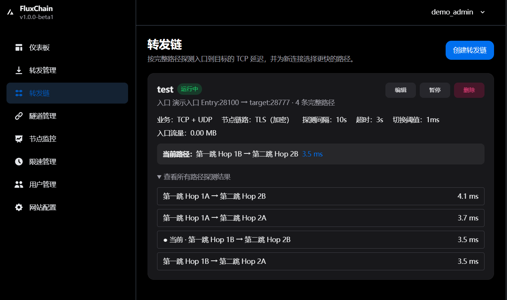
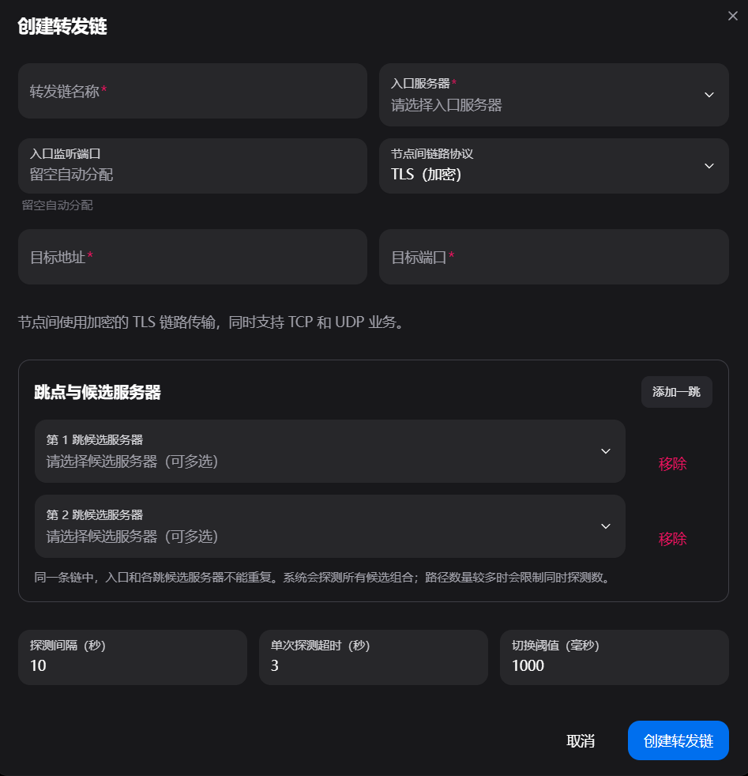

# FluxChain v1.0.1

## 安装面板

支持 x86_64 Linux，使用 MySQL 5.7。请预装 Docker Engine、Docker Compose v2、curl、tar、sha256sum；低内存 VPS 请先启用并持久化 swap。

在当前目录执行，无需编译：

```bash
curl -fL --retry 2 https://raw.githubusercontent.com/Toto0912/flux-chain/main/panel_install.sh -o panel_install.sh && sudo bash panel_install.sh install
```

默认前端端口 `6366`、后端端口 `6365`，安装时可修改。初始账号密码均为 `admin_user`，登录后请修改。

### 使用原项目数据库备份

全新安装前，将备份命名为 `gost.sql`，放在 `panel_install.sh` 同目录。脚本优先使用该文件，恢复后使用原账号密码。**仅在新装面板时导入，执行更新等操作不会导入此数据。**

## 安装与更新节点

在“节点监控”添加服务器，点击“安装”复制命令，以 root 执行。节点支持 amd64、arm64，需 systemd；必须使用本项目定制节点。

在线安装（替换面板后端地址和节点密钥）：

```bash
curl -fL --retry 2 https://github.com/Toto0912/flux-chain/releases/download/v1.0.1/install.sh -o install.sh && sudo bash ./install.sh -a '面板地址:6365' -s '节点密钥'
```

中国大陆服务器下载较慢时，将同版本 `install.sh` 和 `gost-linux-amd64` 上传至节点同一目录，进入该目录执行；ARM64 改用 `gost-linux-arm64`：

```bash
sudo bash ./install.sh -b ./gost-linux-amd64 -a '面板地址:6365' -s '节点密钥'
```

更新节点：

```bash
# 在线更新：移开脚本同目录中的旧二进制文件
curl -fL --retry 2 https://github.com/Toto0912/flux-chain/releases/download/v1.0.1/install.sh -o install.sh && sudo bash ./install.sh -u
# 离线更新：上传同版本脚本和新程序后执行
sudo bash ./install.sh -u -b ./gost-linux-amd64
```

## 更新已有面板

在原安装目录执行，保留 `.env` 和数据库卷：

```bash
sudo bash panel_install.sh backup && curl -fL --retry 2 https://raw.githubusercontent.com/Toto0912/flux-chain/main/panel_install.sh -o panel_install.sh && sudo bash panel_install.sh update
```

## 源码构建

下载完整源码，在仓库根目录执行；构建需联网，已有部署将 `install` 改为 `update`：

```bash
sudo env PANEL_IMAGE_MODE=build bash panel_install.sh install
```

编译节点（需 Go 1.23.4+ 或 Docker，输出至 `artifacts/`）：

```bash
bash build_node.sh amd64 && bash build_node.sh arm64
```

## 离线部署

从 [v1.0.1 Release](https://github.com/Toto0912/flux-chain/releases/tag/v1.0.1) 下载 `fluxchain-offline-amd64-v1.0.1.tar.gz` 和 `SHA256SUMS`，上传至服务器当前目录。预装 Docker 和 Compose 后执行：

```bash
awk '$2 == "fluxchain-offline-amd64-v1.0.1.tar.gz"' SHA256SUMS | sha256sum -c - && tar -xzf fluxchain-offline-amd64-v1.0.1.tar.gz && sudo env PANEL_IMAGE_MODE=load bash panel_install.sh install
```

离线包包含面板、MySQL 镜像及部署资源，不包含 Docker/Compose。已有部署请保留 `.env`，将 `install` 改为 `update`。

基于 [Flux Panel v1.4.3](https://github.com/bqlpfy/flux-panel) 二次开发。保留 [Apache 2.0](LICENSE)、前端 [MIT 许可证](vite-frontend/LICENSE)、字体 [SIL OFL 1.1](springboot-backend/src/main/resources/fonts/OFL.txt) 及各依赖、素材的原有署名与许可。

## 功能演示

转发链与完整路径探测：



创建转发链：


